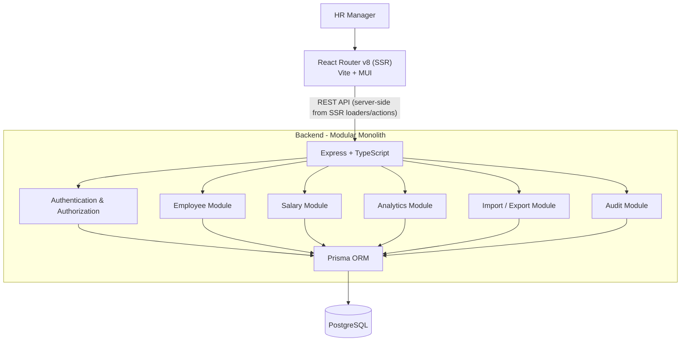

# Tech Stack and High-Level Architecture

## 1. Architecture Overview

The Employee Salary Management System will use a modular monolithic architecture.

The application consists of three main parts:

1. **Frontend:** A web application used by HR Managers to interact with the system.
2. **Backend:** A REST API responsible for business logic, validation, authentication and data operations.
3. **Database:** A relational database that stores employee information, salary records, users and audit history.

The frontend and backend will be maintained as separate applications within the same repository. The backend will be a single deployable application organized into independent functional modules.

This approach provides clear separation of responsibilities while keeping development, testing and deployment simple.

## 2. Technology Stack

### Frontend

| Technology | Purpose |
|---|---|
| React | Component-based UI development |
| React Router v8 (framework mode, SSR) | Routing, server-side route loaders/actions that call the backend API, session cookie relay |
| TypeScript | Static typing and maintainability |
| Vite | Development server and frontend build tooling (via React Router) |
| Material UI (MUI) | UI components, forms, tables, dialogs and layouts (MUI only; no Tailwind) |
| React Hook Form | Form state and submission handling |
| Zod | Form data validation |
| Recharts | Dashboard charts and analytics visualizations (installed; rendered client-side only) |
| Vitest | Frontend unit testing |
| React Testing Library | Component and interaction testing |

### Backend

| Technology | Purpose |
|---|---|
| Bun / Node.js | Package manager and script runner (Bun); the API runs under `tsx` |
| Express | HTTP server and REST API |
| TypeScript | Static typing |
| Prisma 7 | ORM, database access and migrations (driver adapter `@prisma/adapter-pg` + `pg`; config in `prisma7.config.ts`) |
| PostgreSQL | Relational database |
| Zod | Request validation |
| Zod env schema | Environment configuration (`src/config/env.ts`; `.env` loaded via `process.loadEnvFile`) |
| jsonwebtoken, bcryptjs, cookie, cookie-parser | JWT session in an httpOnly cookie, password hashing |
| Helmet | HTTP security headers |
| CORS | Cross-origin request configuration |
| tsx | TypeScript execution during development |
| Vitest | Unit and integration testing |
| Supertest | HTTP API testing |

### Development and Deployment

| Technology | Purpose |
|---|---|
| Git | Version control |
| Bun | Dependency management and scripts |
| Docker Compose | Local PostgreSQL, or the full stack (postgres + backend + frontend) |
| Managed PostgreSQL | Production database hosting |

## 3. High-Level Architecture



### Frontend Responsibilities

The frontend is responsible for:

- Displaying the application interface.
- Managing navigation and page layouts.
- Collecting user input through forms.
- Performing client-side validation for usability.
- Calling backend APIs.
- Displaying API responses, errors and loading states.
- Presenting dashboards, tables and charts.

The frontend must not be responsible for enforcing security or deciding whether a sensitive operation is authorized. These checks belong in the backend.

### Backend Responsibilities

The backend is responsible for:

- Exposing REST API endpoints.
- Authenticating users and enforcing permissions.
- Validating incoming requests.
- Executing employee and salary business logic.
- Managing database transactions.
- Generating analytics and reports.
- Handling CSV imports and exports.
- Recording audit history.
- Returning consistent API responses and errors.

### Database Responsibilities

PostgreSQL will be the system's source of truth.

It will store:

- Employee information.
- Department and organizational information.
- Salary records and salary components.
- Application users and roles.
- Audit logs.
- Any additional configuration data required by the system.

Prisma will provide typed database access, schema management and migrations.

> **Implementation note (foundation phase).** The frontend runs React Router in framework mode with server-side rendering. Route loaders and actions call the backend API on the server (`app/lib/api-client.ts`) and relay the backend's `Set-Cookie` header to the browser, so the browser only talks to the frontend origin. See `docs/04-implementation-status.md` and `docs/implementation/2026-10-02-foundation-summary.md`.

## 4. Backend Architecture

The backend will follow a modular structure with clear separation between HTTP handling, business logic and database operations.

```text
backend/src/
├── config/
├── lib/
├── middleware/
├── modules/
│   ├── employees/
│   │   ├── employee.routes.ts
│   │   ├── employee.controller.ts
│   │   ├── employee.service.ts
│   │   └── employee.schema.ts
│   ├── salaries/
│   ├── analytics/
│   ├── imports/
│   ├── exports/
│   ├── auth/
│   └── audit/
├── app.ts
└── server.ts
```

Each module should contain the code relevant to its functionality.

### Routes

Define HTTP methods, paths and middleware for each API endpoint.

### Controllers

Handle HTTP requests, call the appropriate service and return HTTP responses.

### Services

Contain business logic and coordinate operations between modules and the database.

### Schemas

Define validation rules for API inputs using Zod.

### Middleware

Handle cross-cutting concerns such as authentication, authorization, request processing and centralized error handling.

### Database Access

Use Prisma for database queries and transactions. Database operations should be performed from the appropriate service or a small, focused data-access helper when useful.

## 5. Data Flow

A typical request follows this sequence:

1. The HR Manager performs an action in the frontend.
2. The frontend sends an HTTP request to the appropriate REST endpoint.
3. Express receives the request and applies required middleware.
4. Authentication and authorization are checked where required.
5. The request payload is validated using Zod.
6. The controller invokes the appropriate service.
7. The service performs business logic and uses Prisma to access PostgreSQL.
8. The backend returns a structured response.
9. The frontend updates the interface based on the result.

## 6. Database Design Principles

- Use relational tables for employee, department, salary and user information.
- Use UUIDs or another consistent identifier strategy for primary keys.
- Enforce unique employee IDs and other relevant unique fields.
- Use foreign keys to maintain relationships.
- Store salary amounts using fixed-precision decimal types.
- Store salary revisions as historical records with effective dates.
- Use transactions for operations that must succeed or fail together.
- Add indexes to frequently searched, filtered and joined fields.
- Use migrations to manage schema changes.
- Provide a deterministic seed process for development and testing.

## 7. API Design

The application will use REST APIs with JSON request and response bodies.

Endpoints will be grouped by resource, for example:

| Resource | Endpoint | Responsibility |
|---|---|---|
| Employees | `/api/employees` | List and create employees |
| Employee | `/api/employees/:id` | Retrieve and update employee details |
| Salaries | `/api/employees/:id/salaries` | Retrieve salary history and create revisions |
| Dashboard | `/api/dashboard` | Organisation overview, department/country summaries, recent activity |
| Analytics | `/api/analytics/summary`, `/distribution`, `/groups`, `/trends`, `/filters` | Per-currency statistics, distribution, group comparison, trends and filter options |
| Import | `/api/import/employees` | Import employee data |
| Export | `/api/export/employees` | Export employee data |
| Audit | `/api/audit-logs` | Retrieve audit history |

List endpoints should support pagination, sorting and appropriate filters.

All API endpoints must use consistent status codes and a centralized error response format.

## 8. Security

The system handles sensitive employee and salary information. Security should be implemented as a fundamental part of the architecture.

- Authenticate users before allowing access to protected resources.
- Use secure, HTTP-only cookies for session credentials.
- Hash passwords using a suitable password hashing algorithm.
- Enforce role-based authorization on the backend.
- Validate all incoming request data.
- Use HTTPS in production.
- Protect sensitive operations with appropriate authorization checks.
- Avoid exposing sensitive information in application logs.
- Record important salary changes in the audit log.

## 9. Performance and Scalability

The initial system is designed for an organization with approximately 10,000 employees.

The following practices are sufficient for the initial scale:

- Server-side pagination for employee lists.
- Database indexes for commonly used search and filter fields.
- Database aggregation queries for dashboard metrics.
- Efficient Prisma queries with only the required fields.
- Transactions for critical data updates.
- Stateless backend request handling to allow additional instances if needed.

The architecture should remain simple and should not introduce caching systems, message queues or distributed services without a clear requirement.

## 10. Testing Strategy

### Unit Tests

Test individual business functions, including:

- Employee validation.
- Salary revision rules.
- Salary calculations.
- Authorization rules.
- Analytics calculations.

### Integration Tests

Test interactions between the API, business services and database, including:

- Employee creation and updates.
- Salary revisions and historical records.
- CSV import validation.
- Access control.
- Audit log generation.

### Frontend Tests

Test important forms, tables, navigation and user interactions.

Tests should be deterministic, understandable and focused on critical functionality.

## 11. Deployment

The frontend and backend will be deployed as separate applications, with PostgreSQL hosted as a managed database.

The frontend communicates with the backend through HTTPS REST APIs. The backend connects to PostgreSQL using a secure connection string configured through environment variables.

The application should have separate development and production configurations, database migrations and a health-check endpoint.

## 12. Architectural Decisions

- Use a modular monolith rather than microservices.
- Use REST instead of GraphQL.
- Use PostgreSQL as the single source of truth.
- Use Prisma for typed database operations and migrations.
- Keep business logic in services rather than HTTP controllers.
- Use server-side pagination and database-side analytics. Analytics are Postgres raw SQL aggregations (`prisma.$queryRaw` with `Prisma.sql`) over one shared "current salary per employee" CTE, always per currency.
- Maintain historical salary records instead of overwriting them.
- Keep infrastructure and external dependencies to a minimum.
- Design modules to be independently understandable and testable.